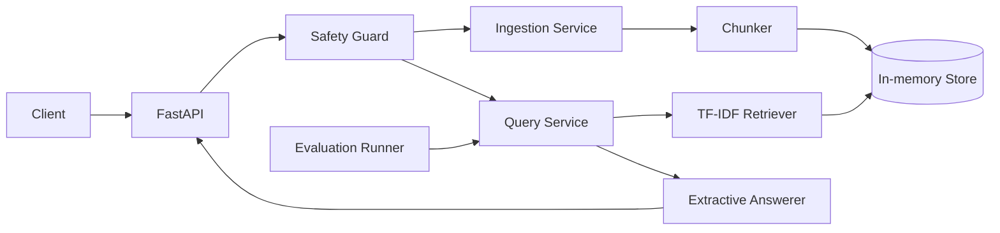

# SecureRAG

An interview-ready document question-answering API that treats retrieval quality and AI safety as first-class engineering problems.

SecureRAG ingests text documents, splits them into traceable chunks, retrieves relevant evidence, blocks common prompt-injection patterns, redacts personally identifiable information (PII), and returns citation-backed answers. The default implementation is deterministic and runs without cloud credentials, which makes the project easy to review and test.

## Why this project exists

Many RAG demos stop after connecting a vector database to an LLM. SecureRAG demonstrates the production concerns around that happy path:

- evidence-backed answers with document and chunk citations;
- input and document safety controls;
- measurable retrieval quality;
- clean service boundaries for changing storage and model providers;
- automated tests, containerisation, and continuous integration.

## Architecture



The in-memory store and extractive answerer are deliberate defaults. Their interfaces can later be implemented with PostgreSQL/pgvector and AWS Bedrock without changing the API layer.

### Use a local model without API charges

Install and start [Ollama](https://ollama.com/download), then download a model. For example, Ollama lists `llama3.2` as a 3B text model (about 2 GB):

```bash
ollama pull llama3.2
```

Configure SecureRAG to call Ollama's local OpenAI-compatible endpoint:

```bash
export SECURERAG_ANSWERER=openai-compatible
export SECURERAG_MODEL_NAME=llama3.2
export SECURERAG_MODEL_BASE_URL=http://localhost:11434/v1
uvicorn securerag.main:app --reload
```

No API key is needed for a localhost endpoint. Ollama serves the model locally, so there are no per-request API charges; model download uses disk space and answering uses your computer's memory and processing power. Ollama documents this compatible endpoint at [its OpenAI compatibility page](https://registry.ollama.com/blog/openai-compatibility).

### Use a hosted answer model

The default answerer is extractive and needs no credentials. To generate answers from retrieved evidence with a hosted OpenAI-compatible chat-completions endpoint, configure these environment variables before starting Uvicorn:

```bash
export SECURERAG_ANSWERER=openai-compatible
export SECURERAG_MODEL_API_KEY='your-api-key'
export SECURERAG_MODEL_NAME='your-chat-model'
# Optional; defaults to https://api.openai.com/v1. Compatible services can use their own /v1 base URL.
export SECURERAG_MODEL_BASE_URL='https://api.openai.com/v1'
uvicorn securerag.main:app --reload
```

The endpoint sends the question and retrieved chunks to the model. Citations still come from the retriever. The prompt asks the model to rely only on retrieved evidence, but this instruction cannot guarantee grounded output; validate model answers before production use. Do not commit API keys.

## Quick start

```bash
python -m venv .venv
source .venv/bin/activate
pip install -e '.[dev]'
uvicorn securerag.main:app --reload
```

Open `http://localhost:8000/docs` for the interactive API documentation.

Load the included public-style sample documents:

```bash
python scripts/load_sample_data.py
```

Or use the API directly:

```bash
curl -X POST http://localhost:8000/v1/documents \
  -H 'Content-Type: application/json' \
  -d '{"title":"Leave policy","source":"handbook","text":"Employees receive 25 days of annual leave each year."}'

curl -X POST http://localhost:8000/v1/query \
  -H 'Content-Type: application/json' \
  -d '{"question":"How many days of annual leave do employees receive?"}'
```

## API

| Method | Path | Purpose |
|---|---|---|
| `GET` | `/health` | Liveness and indexed-document count |
| `POST` | `/v1/documents` | Scan, redact, chunk, and index a document |
| `POST` | `/v1/query` | Retrieve evidence and return a cited answer |
| `POST` | `/v1/evaluate` | Measure retrieval hit rate and reciprocal rank |
| `DELETE` | `/v1/documents` | Clear the local index |

## Safety model

- Questions matching high-confidence prompt-injection patterns are rejected.
- PII is redacted before text is stored.
- Retrieved chunks are treated as untrusted evidence, not instructions.
- Answers are limited to retrieved text and include citations.
- The API never logs raw document contents.

The regex-based guard is intentionally explainable but not sufficient by itself for a high-risk production system. See [docs/threat-model.md](docs/threat-model.md) for limitations and layered mitigations.

For a concise project walkthrough and defensible discussion points, see [docs/interview-guide.md](docs/interview-guide.md).

## Evaluation

`POST /v1/evaluate` accepts labelled questions and expected document IDs. It reports:

- `hit_rate_at_k`: proportion with the expected document in the top-k results;
- `mean_reciprocal_rank`: rewards ranking the expected document near the top;
- per-case rank and pass/fail details.

Run the automated suite:

```bash
pytest
```

## Docker

```bash
docker compose up --build
```

## Engineering decisions

- **Deterministic local baseline:** reviewers can reproduce behaviour without an API key.
- **Dependency injection:** storage, retrieval, and answering components can be replaced independently.
- **Traceable chunks:** every result retains its document, source, and chunk identity.
- **Fail-closed injection handling:** suspicious questions receive a typed `400` response.
- **Evaluation in the product API:** quality regression can become a deployment gate.

## Roadmap

- PostgreSQL/pgvector storage adapter and database migrations
- Bedrock answer generator with structured citations
- semantic embeddings plus hybrid lexical/vector retrieval
- OpenTelemetry traces and latency/cost dashboards
- authentication, rate limiting, and tenant isolation
- adversarial evaluation set and model-based PII detection

## Repository structure

```text
securerag/
├── securerag/          # API and domain services
├── tests/              # unit and API tests
├── scripts/            # local utilities
├── sample_data/        # synthetic, safe demonstration data
├── docs/               # design and threat model
├── Dockerfile
└── compose.yaml
```

## Data and privacy

The bundled documents are synthetic and contain no employer or candidate data. Do not upload confidential documents to a public deployment.

## License

MIT
